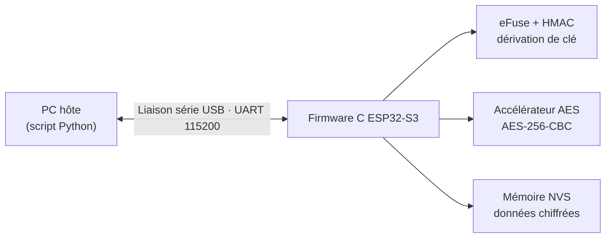
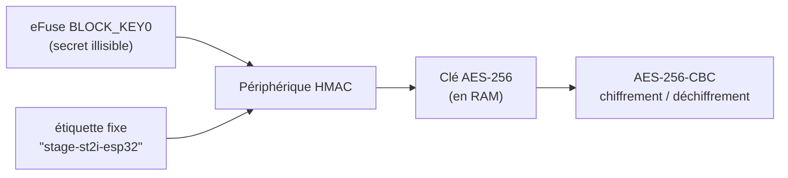
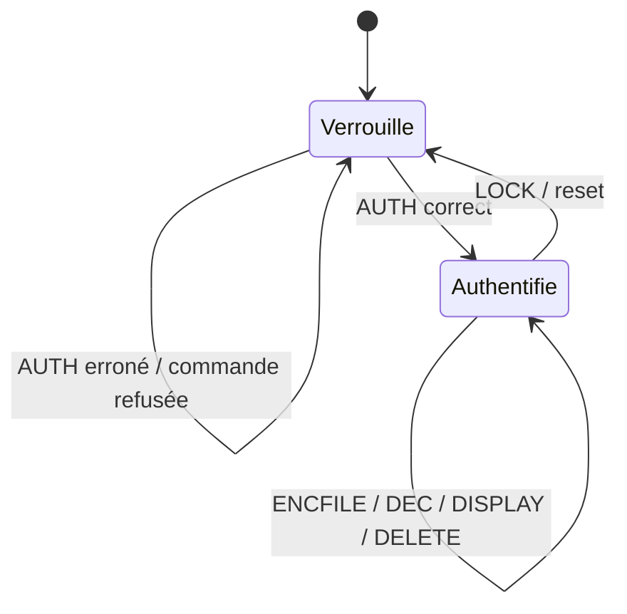

# Coffre-fort matériel ESP32-S3

*[English version](README.md)*

Un **coffre-fort matériel sécurisé** sur microcontrôleur ESP32-S3. Il chiffre des fichiers en AES-256 avec une clé **dérivée dans la puce et jamais lisible**, même par le firmware. L'accès est protégé par un mot de passe, et un outil Python en ligne de commande communique avec la carte via la liaison série USB.

Réalisé lors d'un stage de perfectionnement à l'été 2026 chez **ST2i** (Tunis), au sein du département Études et développement IT.

`C` · `ESP-IDF` · `PlatformIO` · `Python` · `AES-256` · `HMAC` · `eFuse` · `NVS`

---

## Problématique

Le chiffrement logiciel garde généralement sa clé dans un endroit lisible : le code, un fichier ou la flash. Celui qui vole le support récupère alors à la fois le coffre *et* la clé. Ce projet ancre la clé dans le matériel :

- un secret aléatoire de 32 octets est inscrit **une seule fois** dans la mémoire eFuse de l'ESP32-S3, qui devient protégée en lecture ;
- le **périphérique HMAC** de la puce dérive la clé AES-256 au démarrage, sans que le logiciel ne voie jamais le secret ;
- les données stockées ne sont que du texte chiffré, **inexploitable hors de cette puce** et non clonable sur une autre carte.

## Architecture



Le **PC n'est qu'un client** : il lit le fichier, demande le mot de passe et envoie des commandes encodées en hexadécimal. Il ne détient aucun secret et n'effectue aucun chiffrement. Toutes les opérations sensibles se font dans la puce.

### Dérivation de la clé



- **Déterministe :** même puce + même étiquette → même clé à chaque démarrage, ce qui permet de déchiffrer les données stockées.
- **À sens unique :** connaître la clé dérivée ne permet pas de remonter au secret eFuse.
- La clé n'existe qu'en mémoire vive ; elle n'est jamais stockée ni transmise.

### Contrôle par mot de passe

Le mot de passe n'est **jamais stocké**. Le firmware conserve un vérificateur `HMAC(secret eFuse, mot de passe)` en NVS, le recalcule à chaque `AUTH` et compare. Tant que la session n'est pas authentifiée, toutes les commandes de données sont refusées.

### Format de chiffrement

AES-256 en mode CBC sur l'accélérateur matériel, padding PKCS#7, IV aléatoire à chaque chiffrement. Format stocké : `[IV (16 octets) | texte chiffré]`. Les données binaires transitent en hexadécimal.

## Protocole série

| Commande | Rôle | Pré-condition | Réponse |
|---|---|---|---|
| `SETPASS:<mdp>` | Définir le mot de passe (une seule fois) | non provisionné | `OK` / `ERROR` |
| `AUTH:<mdp>` | Déverrouiller la session | provisionné | `UNLOCKED` / `ERROR` |
| `ENCFILE:<hex>` | Chiffrer et stocker un fichier (≤ 3 Ko) | session ouverte | `OK: Encrypted and stored N bytes` |
| `DEC` | Déchiffrer et restituer | session ouverte | `PLAIN:<hex>` |
| `DISPLAY` | Afficher le contenu chiffré | session ouverte | `STORED:<hex>` |
| `DELETE` | Effacer le fichier | session ouverte | `DELETED` |
| `LOCK` | Fermer la session | — | `LOCKED` |



## Organisation du dépôt

```
firmware/        firmware ESP-IDF (projet PlatformIO)
  src/main.c     logique du coffre : dérivation, AES, NVS, protocole série
  platformio.ini configuration de la carte (ESP32-S3-DevKitC-1, 16 Mo de flash)
  partitions.csv table de partitions
host/host.py     outil Python côté PC
examples/        fichier d'exemple sans valeur pour la démo
```

## Mise en route

**Matériel :** ESP32-S3-DevKitC-1 (testé sur la variante N16R8), câble USB, PC sous Linux.

> ⚠️ **L'écriture d'un eFuse est irréversible.** Une fois le bloc de clé écrit et protégé, il ne peut plus être modifié ni relu. Utilisez une carte dédiée à ce projet.

**1. Provisionner la clé matérielle (une fois par carte)**

```bash
# générer un secret aléatoire de 32 octets ; ne JAMAIS le mettre dans un dépôt
python3 -c "import os; open('hmac_key.bin','wb').write(os.urandom(32))"

# l'inscrire dans BLOCK_KEY0 avec l'usage HMAC_UP (irréversible)
espefuse.py --port /dev/ttyUSB0 burn_key BLOCK_KEY0 hmac_key.bin HMAC_UP

# vérifier : le bloc doit apparaître illisible (?? ?? ...)
espefuse.py --port /dev/ttyUSB0 summary
```

**2. Compiler et téléverser le firmware**

```bash
cd firmware
pio run -t upload --upload-port /dev/ttyUSB0
```

**3. Utiliser le coffre depuis le PC**

```bash
cd host
pip install -r requirements.txt
# le port série se règle en haut de host.py (par défaut /dev/ttyUSB0)

python3 host.py setpass                      # définir le mot de passe
python3 host.py encrypt ../examples/sample.txt
python3 host.py display                      # seul le texte chiffré est stocké
python3 host.py decrypt recovered.txt        # restitution octet par octet
python3 host.py delete
```

## Tests

Validé sur tout le cycle de vie d'un fichier protégé :

- un mot de passe correct déverrouille la session ; un mot de passe erroné la laisse verrouillée et toute opération est refusée ;
- chiffrement → stockage → déchiffrement restitue l'original **octet par octet**, pour un fichier texte comme pour une image ;
- `DISPLAY` montre que seul du texte chiffré illisible est stocké sur la carte ;
- `espefuse summary` confirme que le bloc de clé apparaît `??` (protégé en lecture, usage `HMAC_UP`).

## Analyse de sécurité et limites

Objectif atteint : les données stockées sont inexploitables sans la puce, et la clé ne peut pas être extraite, même par le firmware.

Limites connues et pistes d'amélioration :

| Limite | Piste |
|---|---|
| La vérification du mot de passe est logicielle : un reflashage pourrait la contourner. L'attaquant n'obtiendrait cependant que du texte chiffré. | Intégrer le mot de passe dans la dérivation de la clé ; activer **Secure Boot** et **Flash Encryption** (mesures permanentes, à manier avec précaution). |
| AES-CBC assure la confidentialité mais pas l'intégrité : un texte chiffré modifié n'est pas détecté. | Passer à un mode authentifié comme **AES-GCM**, ou ajouter un HMAC sur les données. |
| Pas de limite au nombre de tentatives de mot de passe. | Compteur de tentatives avec délai ou blocage. |
| Un accès physique permet d'effacer la flash. Cela détruit les données sans les révéler. | Stratégie de sauvegarde externe. |
| Un seul fichier stocké, de 3 Ko maximum. | Stockage multi-fichiers par blocs en NVS ou sur une partition dédiée. |

## Compétences mobilisées

C embarqué sous ESP-IDF, cryptographie appliquée (AES, HMAC, dérivation de clé), architecture client–serveur sur liaison série, analyse de la menace, et rigueur face aux opérations irréversibles comme l'écriture d'eFuse.

---

*Auteur : Louay Amara*
