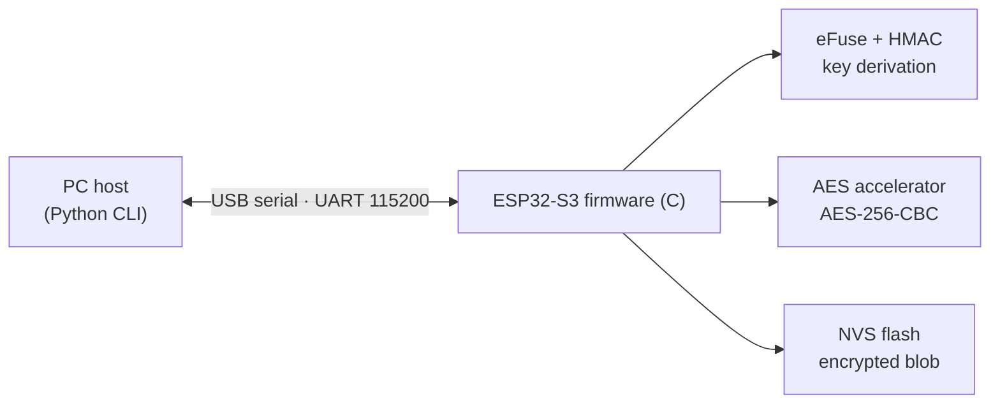
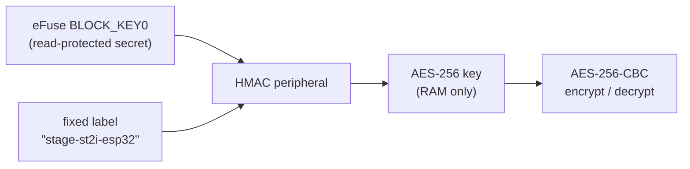
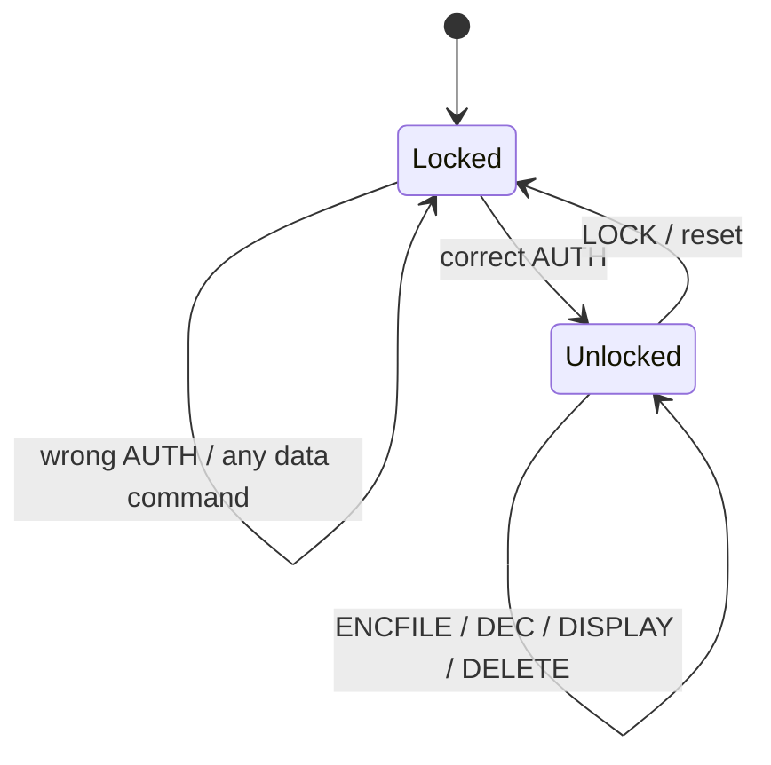

# ESP32-S3 Hardware Vault

*[Version française](README.fr.md)*

A small **hardware-backed secure vault** running on an ESP32-S3. It encrypts files with AES-256 using a key that is **derived inside the chip and can never be read out**, not even by the firmware itself. Access is gated by a passphrase, and a Python command-line tool on the PC talks to the board over USB serial.

Built during a summer 2026 internship at **ST2i** (Tunis), in the IT studies & development department.

`C` · `ESP-IDF` · `PlatformIO` · `Python` · `AES-256` · `HMAC` · `eFuse` · `NVS`

---

## The problem

Software encryption usually keeps its key somewhere readable: in the code, in a file or in flash. Whoever steals the device gets both the safe *and* the key. This project anchors the key in the hardware instead:

- a random 32-byte secret is burned **once** into the ESP32-S3's eFuse memory and becomes read-protected;
- the on-chip **HMAC peripheral** turns that secret into the AES-256 key at boot, without software ever seeing the secret;
- the stored data is only ciphertext, **useless off this particular chip** and impossible to clone to another board.

## Architecture



The **PC is only a client**: it reads the file, asks for the passphrase and sends hex-encoded commands. It holds no secrets and does no cryptography. Everything sensitive happens on the chip.

### Key derivation



- **Deterministic:** same chip + same label → same key at every boot, so stored data can be decrypted later.
- **One-way:** knowing the derived key doesn't reveal the eFuse secret.
- The key lives only in RAM; it is never stored or sent over serial.

### Passphrase check

The passphrase is **never stored**. The firmware keeps a verifier `HMAC(eFuse secret, passphrase)` in NVS, recomputes it on each `AUTH` and compares. Until a session is authenticated, every data command is refused.

### Encryption format

AES-256 in CBC mode on the hardware accelerator, PKCS#7 padding, a fresh random IV per encryption. Stored blob: `[IV (16 bytes) | ciphertext]`. Binary data crosses the serial link as hex.

## Serial protocol

| Command | What it does | Requires | Reply |
|---|---|---|---|
| `SETPASS:<pass>` | Set the passphrase (once) | not provisioned | `OK` / `ERROR` |
| `AUTH:<pass>` | Unlock the session | provisioned | `UNLOCKED` / `ERROR` |
| `ENCFILE:<hex>` | Encrypt and store a file (≤ 3 KB) | unlocked | `OK: Encrypted and stored N bytes` |
| `DEC` | Decrypt and return the file | unlocked | `PLAIN:<hex>` |
| `DISPLAY` | Show the stored ciphertext | unlocked | `STORED:<hex>` |
| `DELETE` | Wipe the stored file | unlocked | `DELETED` |
| `LOCK` | End the session | none | `LOCKED` |



## Repository layout

```
firmware/        ESP-IDF firmware (PlatformIO project)
  src/main.c     vault logic: key derivation, AES, NVS, serial protocol
  platformio.ini board config (ESP32-S3-DevKitC-1, 16 MB flash)
  partitions.csv custom partition table
host/host.py     Python CLI used on the PC
examples/        harmless sample file for the demo
```

## Running it

**Hardware:** ESP32-S3-DevKitC-1 (tested on the N16R8 variant), USB cable, Linux PC.

> ⚠️ **Burning an eFuse is permanent.** Once the key block is written and read-protected, it can never be changed or read back. Use a board you're happy to dedicate to this.

**1. Provision the hardware key (once per board)**

```bash
# generate a random 32-byte secret; keep it OFF any repo
python3 -c "import os; open('hmac_key.bin','wb').write(os.urandom(32))"

# burn it into BLOCK_KEY0 with the HMAC_UP purpose (irreversible)
espefuse.py --port /dev/ttyUSB0 burn_key BLOCK_KEY0 hmac_key.bin HMAC_UP

# check: the key block should now show as unreadable (?? ?? ...)
espefuse.py --port /dev/ttyUSB0 summary
```

**2. Build and flash the firmware**

```bash
cd firmware
pio run -t upload --upload-port /dev/ttyUSB0
```

**3. Use the vault from the PC**

```bash
cd host
pip install -r requirements.txt
# the serial port is set at the top of host.py (default /dev/ttyUSB0)

python3 host.py setpass                      # set the passphrase once
python3 host.py encrypt ../examples/sample.txt
python3 host.py display                      # only ciphertext is stored
python3 host.py decrypt recovered.txt        # byte-for-byte round trip
python3 host.py delete
```

## Tests

Validated over a file's whole life cycle:

- a correct passphrase unlocks the session; a wrong one keeps it locked and every data command is refused;
- encrypt → store → decrypt returns the original **byte for byte**, for both a text file and an image;
- `DISPLAY` shows that only unreadable ciphertext is stored on the chip;
- `espefuse summary` confirms the key block reads back as `??` (read-protected, purpose `HMAC_UP`).

```text
$ python3 host.py encrypt secret.txt
[*] UNLOCKED: Authenticated
[+] OK: Encrypted and stored 51 bytes

$ python3 host.py display
[*] UNLOCKED: Authenticated
[!] STORED: 5DE2B36D1AD133DCA8FF85602272D5B0ACBEE14A2FB05E3E1357...
```

## Security analysis and limitations

What it achieves: stored data is useless without the physical chip, and the key can't be extracted, not even by the firmware.

Known limits, and how I'd address them next:

| Limitation | Next step |
|---|---|
| The passphrase check is enforced in software, so reflashing a modified firmware could skip it. The attacker would still only get ciphertext, since the key stays in hardware. | Mix the passphrase into the key derivation, and enable **Secure Boot** and **Flash Encryption** (both permanent, so to be handled carefully). |
| AES-CBC gives confidentiality but no integrity check: a modified ciphertext isn't detected. | Switch to an authenticated mode such as **AES-GCM**, or add an HMAC over the blob. |
| No limit on wrong passphrase attempts. | Add an attempt counter with a delay or lockout. |
| Someone with physical access can erase the flash. That destroys the data but doesn't reveal it. | Pair the vault with an external backup strategy. |
| One stored file of at most 3 KB. | Store multiple files in chunks in NVS or on a dedicated partition. |

## What I learned

Embedded C on ESP-IDF, applied cryptography (AES, HMAC, key derivation), client–server design over a serial link, threat modelling, and working carefully with irreversible operations such as eFuse burning.

---

*Author: Louay Amara*
